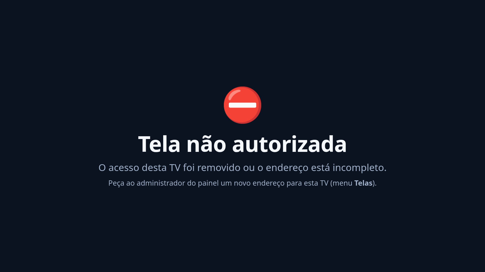

# Painel de Avisos

Quadro de comunicados para as TVs da empresa. O líder publica um aviso pelo navegador e ele aparece
**na hora** (em menos de 1 segundo) nas TVs.

Funciona de dois jeitos:

- **Rede local (LAN)**: um `.exe` no Windows, sem internet. Veja [Instalação no Windows](#instalação-no-windows-rede-local).
- **Internet (HTTPS)**: container Docker atrás de um Traefik, ex.: `https://avisos.protatic.qosit.cloud`.
  Veja [Publicação na internet com Traefik](#publicação-na-internet-com-traefik).


| Tela ociosa | Aviso urgente | Painel do líder | Telas e chaves |
|---|---|---|---|
|  |  |  |  |

| Sem servidor (cache offline) | Chave inválida/revogada | Configurações |
|---|---|---|
|  |  |  |

Opcional (`SHOW_SERVER_INFO=1`, só admin): [Detalhes técnicos](screenshots/09-admin-detalhes-tecnicos-opcional.png).

## O que é

Um único programa (`painel-avisos.exe` / `painel-avisos-linux-amd64`, cerca de 12 MB, sem dependências). Ele:

- serve o **painel do líder** em `/admin` (usuário + senha, com 2FA opcional);
- serve a **tela da TV** em `/tela?screen=<nome>&key=<chave>`;
- guarda tudo num SQLite na pasta de dados: avisos, usuários, telas, imagens e histórico.

**Recursos**

- **Prioridade**: um aviso *Normal* entra no rodízio (15 s por padrão). Um *Urgente* aparece em vermelho, com pulsação e alerta sonoro. Por padrão ele fica 60 s na tela, apitando a cada 10 s; depois passam os avisos normais uma vez e o urgente volta (veja "Avisos urgentes").
- **Validade**: início e fim agendáveis. Sem fim, o aviso fica até alguém encerrar.
- **Várias TVs**: cada uma tem nome e **chave própria**. O aviso vai para todas ou para algumas.
- **Vários líderes**: cada um com login. O histórico registra quem publicou, editou e encerrou.
- **Imagem** no aviso e **logo** da empresa, servidos só para usuários logados ou TVs com chave.
- **Formatação simples**: `**negrito**`, `*itálico*`, `__sublinhado__`, e linhas começando com `- ` viram lista.
- **Tempo real** via Server-Sent Events, com reconexão automática.
- **Resiliência**: se o servidor ou a internet cair, a TV continua com o último conteúdo e mostra "reconectando…".
  Com HTTPS (ou servidor no próprio PC da TV), a TV **abre até depois de reiniciar sem rede**, graças ao service worker.
- **Status das TVs** (online/offline) e **webhook** opcional quando uma TV some, protegido contra SSRF.
- **API com token** para publicar avisos a partir de outros sistemas (Zabbix, scripts).

### Novidades da versão 1.1 (segurança para publicar na internet)

| Recurso | Resumo |
|---|---|
| Chave por tela | Cada TV tem uma chave aleatória (só o hash fica no banco). Ela é exibida uma vez e pode ser regenerada ou revogada; a TV é derrubada na hora. Sem chave válida, a TV mostra **"Tela não autorizada"** (HTTP 401/403). |
| Uploads protegidos | `/uploads/` exige sessão logada ou chave de tela válida. |
| Proxy reverso | `TRUST_PROXY` diz em quais proxies confiar para `X-Forwarded-For/Proto`, usados no IP real (limite de login, auditoria), no cookie `Secure` e no HSTS. |
| Cabeçalhos | CSP estrita (sem script/style inline), HSTS em HTTPS, `X-Frame-Options: DENY`, `Referrer-Policy: no-referrer`, `Permissions-Policy`, `nosniff`, COOP/CORP. |
| Webhook anti-SSRF | Bloqueia loopback, redes privadas, link-local, CGNAT, metadados de nuvem (169.254.169.254, fd00:ec2::254), NAT64 e equivalentes IPv6. A checagem acontece **no momento da conexão** (derrota DNS rebinding) e também nos redirecionamentos. |
| 2FA (TOTP) | Opcional por usuário, com QR code. O código é pedido no login, com anti-replay. Se o celular se perder, um admin reseta. |
| Offline | Service worker guarda a página, os arquivos e as imagens da TV. Se a chave for revogada, o cache é apagado. |

### Versão 1.2.1

- Instalador Windows: tarefa agendada por tela, logon automático opcional, diagnóstico e desinstalação.
- Só o script do Windows mudou funcionalmente; a VM não precisa ser atualizada.

### Versão 1.2.0

- **Aviso urgente intercalado (novo padrão):** o urgente fica 60 s na TV, com alerta sonoro a cada 10 s. Depois passa um ciclo dos avisos normais e o urgente volta, apitando de novo. Antes ele ocupava a tela sozinho e parava o rodízio.
- Novas opções em **Configurações > Avisos urgentes**: modo (*Intercalar com os avisos normais* ou *Fixo na tela até sair do ar*), tempo do urgente na tela (10 a 600 s, padrão 60) e repetir o alerta a cada 10 s (padrão ligado).
- Instalações existentes passam para o novo padrão sozinhas ao atualizar, sem perder nada. Para manter o comportamento antigo, escolha *Fixo na tela até sair do ar*.
- A TV agora recarrega sozinha quando o servidor é atualizado, mantendo a posição do rodízio. Isso vale a partir desta versão; veja abaixo como pegar a 1.2.0 na TV.

### Versão 1.1.3

- Quiosque em **PC com vários monitores**: `install-tv-kiosk.ps1 -ListMonitors` e `-Monitor <n>` (veja "PC com vários monitores").
- Várias telas no mesmo PC: reinstalar uma tela não fecha mais o Edge de outra quando um nome é começo do outro (ex.: `tv` e `tv-2`).
- Só mudou o script do Windows. O servidor não mudou: atualizar a VM é opcional (só muda a versão exibida).

### Versão 1.1.2

- **Correção:** com 2 ou mais avisos normais, a TV podia ficar presa no primeiro aviso. A barra do rodízio enchia, mas a troca não acontecia. A causa era a página da TV ser reaberta a cada poucos segundos, o que voltava sempre ao 1º aviso.
  - O lançador do quiosque (`install-tv-kiosk.ps1`) esperava o `msedge.exe` terminar e reabria o Edge 5 s depois. Quando já havia um Edge aberto com o mesmo perfil (por exemplo, o instalador executado 2 vezes, ou dois atalhos de inicialização), o `msedge.exe` saía na hora e abria a tela de novo em outra aba, sem parar.
  - Agora existe um único lançador por tela. Ele só reabre o Edge se não houver nenhum Edge do quiosque rodando. Reinstalar encerra os lançadores antigos e remove o atalho duplicado.
  - A TV também guarda a posição do rodízio: se a página for reaberta, ela continua do aviso em que estava. O tempo é medido com relógio monotônico, então um ajuste do relógio do Windows não trava a troca.
- Cache da TV atualizado (`painel-tela-v4`). A TV pega o código novo na próxima vez que a página abrir.
- **Na TV:** execute de novo o `install-tv-kiosk.ps1` (mesmos parâmetros). Isso encerra o loop antigo e reabre o Edge já com a versão nova.

### Versão 1.1.1

- A tela **Configurações** não mostra mais informações técnicas do servidor (modo, proxies, IP). Elas continuam no log de inicialização e, se quiser, numa seção recolhida **"Detalhes técnicos"** só para admin (`SHOW_SERVER_INFO=1`).
- Textos do painel e da TV revisados para o cliente final: "Integrações" no lugar de "API/Tokens", "Aviso automático" no lugar de "Webhook", mensagens de erro sem códigos técnicos, versão discreta no rodapé.
- Nenhuma mudança no comportamento de segurança.

## Arquitetura

```
LAN (Windows)                                       Internet (VM 10.60.20.10 com Traefik)
PC do líder ──http──> PC da TV (servidor :8080)     Navegador/TV ──https──> Traefik ──rede docker──> painel-avisos:8080
                      └─ Edge quiosque (127.0.0.1)                          (TLS, ipAllowList)           (sem porta publicada)
```

---

## Instalação no Windows (rede local)

Requisitos: Windows 10/11 64 bits e Microsoft Edge. Use **IP fixo** no PC servidor (reserva DHCP).

### 1. PC da TV (servidor + tela)

1. Copie a pasta `painel-avisos` deste ZIP para o PC (ex.: `C:\Instaladores\painel-avisos`).
2. Abra o **PowerShell como Administrador** e rode:
   ```powershell
   cd C:\Instaladores\painel-avisos\deploy\windows
   Set-ExecutionPolicy -Scope Process Bypass -Force
   .\install-server.ps1                      # ou: .\install-server.ps1 -RequireScreenKeys
   ```
   O script:
   - copia o programa para `C:\PainelAvisos\`;
   - cria os dados em `C:\ProgramData\PainelAvisos\` (acesso só de SYSTEM e Administradores);
   - **mostra a senha do `admin` uma única vez**;
   - libera a porta 8080 no Firewall (redes Privada e Domínio);
   - cria a tarefa **PainelAvisos** (sobe no boot como SYSTEM e reinicia se cair);
   - desliga a suspensão do PC.

   `-RequireScreenKeys` exige chave em todas as TVs (recomendado). Sem essa opção, TVs antigas sem chave continuam aceitas (modo legado).
3. Entre em `http://127.0.0.1:8080/admin` > **Telas** > *Adicionar tela* (ex.: `tv-principal`) e **copie a chave exibida**.
4. Configure o quiosque, logado com o usuário que fica na TV:
   ```powershell
   .\install-tv-kiosk.ps1 -Server 127.0.0.1:8080 -Screen tv-principal -Key tk_COLE_A_CHAVE_AQUI
   ```
5. Configure o logon automático (`netplwiz`) e, na BIOS, "Restore on AC Power Loss = Power On".
   Veja `deploy/windows/disable-sleep-screensaver.txt`.

### 2. PC do líder

Abra `http://192.168.1.195:8080/admin` ou crie um atalho com `.\install-leader-shortcut.ps1 -Server 192.168.1.195:8080`.

### Atualizar, remover, recuperar

- **Atualizar**: troque o `.exe` e rode `install-server.ps1` de novo. Os dados são mantidos.
- **Remover**: `uninstall-server.ps1` (ou `uninstall-server.ps1 -RemoveData` para apagar os dados).
- **Esqueci a senha ou perdi o 2FA do admin**: `C:\PainelAvisos\painel-avisos.exe reset-admin -data C:\ProgramData\PainelAvisos`
  gera uma nova senha e remove o 2FA do admin.
- **Backup**: `painel-avisos.exe backup -data C:\ProgramData\PainelAvisos -out D:\backup\painel.db`
  (cópia consistente com o servidor ligado). Copie também a pasta `uploads`.

---

## Publicação na internet com Traefik

Alvo: `https://avisos.protatic.qosit.cloud`, na VM `10.60.20.10`, que já roda Traefik em Docker.
O kit está em `deploy/traefik/`.

### Pré-requisitos

1. **Docker + Compose v2** na VM (`docker compose version`).
2. **DNS**: um registro `A` (ou `CNAME`) de `avisos.protatic.qosit.cloud` para o **IP público** que chega ao Traefik.
   Pode ser NAT/port-forward de 443 (e 80, se o desafio ACME for HTTP-01) para a `10.60.20.10`.
   Se o Traefik usa um certificado curinga `*.protatic.qosit.cloud` (desafio DNS), não precisa de mais nada.
3. **Traefik** v2 ou v3 com provider Docker, um entrypoint HTTPS e um certresolver.
   O kit foi testado com Traefik **v3.5** e **v2.11**.

### Descobrir os nomes do Traefik (rede, entrypoint, certresolver)

```bash
# 1) container e versão do Traefik
docker ps --format '{{.Names}}\t{{.Image}}' | grep -i traefik
docker exec <traefik> traefik version

# 2) rede(s) Docker do Traefik  -> TRAEFIK_NETWORK
docker inspect <traefik> -f '{{range $k,$v := .NetworkSettings.Networks}}{{$k}} {{end}}'
docker network ls

# 3) sub-rede dessa rede  -> TRUST_PROXY (o ideal é exatamente este CIDR)
docker network inspect <rede> -f '{{range .IPAM.Config}}{{.Subnet}}{{end}}'

# 4) entrypoints e certresolvers -> TRAEFIK_ENTRYPOINT / TRAEFIK_CERTRESOLVER
docker inspect <traefik> -f '{{json .Args}}' | tr ',' '\n' | grep -Ei 'entrypoints\.|certificatesresolvers\.'
#    se a config estiver em arquivo (traefik.yml/toml), veja onde está montado e leia:
docker inspect <traefik> -f '{{range .Mounts}}{{.Source}} -> {{.Destination}}{{"\n"}}{{end}}'
#    jeito mais fácil: copiar de um serviço que JÁ funciona atrás desse Traefik
docker inspect <outro-servico> -f '{{json .Config.Labels}}' | tr ',' '\n' | grep -Ei 'entrypoints|certresolver|middlewares'

# 5) existe compress global no entrypoint? (atrapalha o tempo real, veja "SSE e compressão")
docker inspect <traefik> -f '{{json .Args}}' | tr ',' '\n' | grep -i 'middlewares'
```

### Passo a passo na VM

```bash
# 1) copiar o projeto (pasta painel-avisos do ZIP) para a VM
sudo mkdir -p /opt/painel-avisos && sudo chown $USER /opt/painel-avisos
#   (scp/rsync do ZIP, depois unzip em /opt/painel-avisos)
cd /opt/painel-avisos/deploy/traefik

# 2) configurar
cp .env.example .env
nano .env        # DOMAIN, TRAEFIK_NETWORK, TRAEFIK_ENTRYPOINT, TRAEFIK_CERTRESOLVER, TRUST_PROXY
chmod 600 .env

# 3) validar e subir
docker compose config >/dev/null && echo "compose OK"
docker compose up -d --build

# 4) senha inicial do admin (aparece só no primeiro start)
docker compose logs painel-avisos | grep -A1 'PRIMEIRO USO'

# 5) testar
curl -sI https://avisos.protatic.qosit.cloud/healthz       # 200, com strict-transport-security
```

Depois do start, o Traefik só publica o container quando ele fica **healthy** (cerca de 10 s). Antes disso, o Traefik responde 404.

Primeiro acesso em `https://avisos.protatic.qosit.cloud/admin`:

1. Troque a senha (Minha conta) e **ative o 2FA**.
2. Crie os usuários dos líderes.
3. Crie as telas e anote as chaves.
4. Configure nome e logo da empresa.

### Variáveis do `.env`

| Variável | Obrigatória | Padrão | O que é |
|---|---|---|---|
| `DOMAIN` | **sim** | `avisos.protatic.qosit.cloud` | Domínio público (regra `Host()` e `PUBLIC_URL`) |
| `TRAEFIK_NETWORK` | **sim** (confirmar) | `proxy` | Rede Docker externa do Traefik (comum: `proxy`, `traefik`, `traefik_proxy`, `web`) |
| `TRAEFIK_ENTRYPOINT` | **sim** (confirmar) | `websecure` | Entrypoint HTTPS (comum: `websecure`, `https`) |
| `TRAEFIK_CERTRESOLVER` | **sim** (confirmar) | `letsencrypt` | Certresolver ACME (comum: `letsencrypt`, `le`). Se o Traefik usa certificado curinga via arquivo, use o resolver que emite o curinga ou peça ajuste |
| `TRUST_PROXY` | recomendado | `172.16.0.0/12,192.168.0.0/16` | CIDRs do Traefik. O ideal é a sub-rede exata da rede do Traefik |
| `ALLOW_KEYLESS` | não | `0` | `1` aceita TVs sem chave. **Não use na internet** |
| `WEBHOOK_ALLOW_PRIVATE` | não | `0` | `1` permite webhook para IPs privados (10/8, 172.16/12, 192.168/16, 100.64/10, fc00::/7) |
| `WEBHOOK_URL` | não | vazio | Webhook de TV offline (substitui o valor configurado no painel a cada start) |
| `SHOW_SERVER_INFO` | não | `0` | `1` mostra uma seção recolhida **"Detalhes técnicos"** em Configurações (modo, URL, proxies confiáveis, IP visto), **só para admin**. Com `0` (padrão) nada disso aparece nem é enviado ao navegador; os mesmos dados ficam no log: `docker compose logs painel-avisos \| grep modo:` |
| `ADMIN_INITIAL_PASSWORD` | não | vazio | Senha do admin no **primeiro** start. Vazio = gerada e mostrada no log (recomendado) |
| `ADMIN_ALLOWED_IPS` + `COMPOSE_FILE` | não | — | Restringe o painel administrativo por IP (veja abaixo) |
| `BACKUP_DIR`, `BACKUP_RETENTION_DAYS` | não | `/opt/painel-avisos/backups`, `14` | Usados por `backup.sh` |

O container escuta em `0.0.0.0:8080` **dentro** da rede Docker. O compose **não publica portas**, então só o Traefik alcança o container.

### Restringir o painel administrativo por IP (opcional, recomendado)

Bloqueia por IP o `/admin`, `/api/admin`, `/api/v1`, `/api/login`, `/api/logout` e `/api/me`.
`/tela`, `/api/screen`, `/uploads`, `/static` e `/healthz` continuam abertos, porque as TVs usam a chave delas.

No `.env`:
```bash
ADMIN_ALLOWED_IPS=200.200.200.200/32,10.60.0.0/16
COMPOSE_FILE=docker-compose.yml:docker-compose.allowlist-v3.yml    # Traefik v3 (ipAllowList)
# COMPOSE_FILE=docker-compose.yml:docker-compose.allowlist-v2.yml  # Traefik v2 (ipWhiteList)
```
Depois rode `docker compose up -d`. As mesmas labels estão comentadas no `docker-compose.yml`, caso prefira editar direto.

Se houver outro proxy ou CDN **na frente** do Traefik, o IP visto é o desse proxy. Nesse caso configure
`forwardedHeaders.trustedIPs` no entrypoint ou `ipallowlist.ipstrategy.depth=1` no middleware.

### SSE (tempo real) e compressão

- O router do painel **não deve** usar o middleware `compress`. Testado no Traefik v3.5: com `compress`, o
  `text/event-stream` passa a ser compactado (gzip), fica preso em buffer e a TV para de receber avisos.
- Se o entrypoint tiver `compress` global, configure `excludedContentTypes=text/event-stream` no middleware
  (também testado: com essa exclusão, o tempo real funciona normalmente).
- Não é preciso ajustar `responseForwarding.flushInterval`: o Traefik repassa `text/event-stream` na hora
  (medido: 3 a 6 ms entre publicar e chegar na TV, no v3.5 e no v2.11).
  O servidor manda `ping` a cada 15 s, então timeouts de ociosidade (ex.: `idleTimeout` de 180 s) não derrubam a conexão.

### Atualizar a versão (mantendo os dados)

Os dados (banco, imagens, logo) ficam no volume Docker **`painel-avisos_painel-data`**. O nome do projeto é fixo no compose (`name: painel-avisos`), então o volume é o mesmo em qualquer atualização.
**Nunca** use `docker compose down -v`: o `-v` apaga o volume.

```bash
# 0) backup antes de atualizar
sudo /opt/painel-avisos/deploy/traefik/backup.sh

# 1) guardar uma cópia do .env (o ZIP NÃO contém .env, então ele não é sobrescrito, mas por garantia)
cp /opt/painel-avisos/deploy/traefik/.env ~/painel-avisos.env.bak

# 2) substituir os arquivos pelos do ZIP novo (a pasta do ZIP é painel-avisos/)
unzip -o ~/painel-avisos.zip -d /opt
chmod +x /opt/painel-avisos/deploy/traefik/*.sh
cmp -s ~/painel-avisos.env.bak /opt/painel-avisos/deploy/traefik/.env && echo ".env preservado"

# 3) (1.1.1) variável nova opcional; o padrão já é 0
grep -q '^SHOW_SERVER_INFO=' /opt/painel-avisos/deploy/traefik/.env || echo 'SHOW_SERVER_INFO=0' >> /opt/painel-avisos/deploy/traefik/.env
#    se o seu .env tiver PAINEL_VERSION=..., ajuste para a versão nova (só muda a tag da imagem)

# 4) reconstruir e subir
cd /opt/painel-avisos/deploy/traefik
docker compose up -d --build
docker compose ps                                      # aguarde "healthy" (~10 s)
docker compose logs --tail 20 painel-avisos | grep -E 'modo:|versao'
curl -s https://avisos.protatic.qosit.cloud/healthz    # {"ok":true,"version":"1.2.1"}
```
Usuários, telas, chaves das TVs, 2FA e avisos são mantidos. As TVs reconectam sozinhas em segundos.
Ao abrir o painel, faça **Ctrl+F5** uma vez para garantir a interface nova.

**TVs:** a partir da 1.2.0, a TV recarrega sozinha quando o servidor é atualizado. Uma TV que ainda está com a 1.1.x aberta não tem esse recurso: ela continua funcionando como antes (urgente fixo) até recarregar. Isso acontece sozinho na recarga diária das 4h. Para ver o urgente intercalado na hora, aperte **F5** na TV, ou **Alt+F4** (o lançador reabre o Edge em até 5 s).

### Backup diário

```bash
chmod +x backup.sh restore.sh
sudo ./backup.sh                                  # teste manual
sudo crontab -e                                   # agenda diária às 03:15:
15 3 * * * /opt/painel-avisos/deploy/traefik/backup.sh >> /var/log/painel-avisos-backup.log 2>&1
```
O `backup.sh` faz:

- uma cópia consistente do SQLite com o servidor ligado (`VACUUM INTO`, equivalente ao `.backup`, com `integrity_check`), compactada em `.db.gz`;
- um `.tar.gz` das imagens;
- permissões 600 e retenção de `BACKUP_RETENTION_DAYS` dias.

Restaurar: `sudo ./restore.sh /opt/painel-avisos/backups/painel-AAAAMMDD-HHMMSS.db.gz [uploads-....tar.gz]`.

### Monitoramento no Zabbix

**Cenário web** (host da VM ou um host "avisos"):

- Configuração > Hosts > Web > Criar cenário, intervalo `1m`, 2 tentativas.
- Passo 1: URL `https://avisos.protatic.qosit.cloud/healthz`, *Required string* `"ok":true`, *Required status codes* `200`, timeout `10s`.
- Trigger: `last(/HOST/web.test.fail[Painel de Avisos])<>0` (ou `min(...,#3)>0` para evitar alarme falso).
- Opcional: template *Website certificate by Zabbix agent 2* para acompanhar a validade do certificado.
- Opcional na VM: `docker inspect -f '{{.State.Health.Status}}' painel-avisos` (UserParameter) deve retornar `healthy`.

Para alertar quando uma **TV** sai do ar, use o webhook de TV offline (Configurações), apontando para um endpoint público,
ou para um IP privado com `WEBHOOK_ALLOW_PRIVATE=1`.

### Configurar a TV (quiosque) apontando para a internet

No PC da TV (Windows), com a pasta `deploy\windows`:
```powershell
.\install-tv-kiosk.ps1 -Url https://avisos.protatic.qosit.cloud -Screen tv-principal -Key tk_COLE_A_CHAVE_AQUI
```
- A chave fica no lançador `C:\PainelAvisos\tv-kiosk-<tela>.ps1`, com leitura restrita ao usuário, SYSTEM e Administradores.
- O lançador espera o servidor até `-WaitSeconds` (120 s por padrão) e depois abre o Edge assim mesmo.
  Sem internet, a TV abre pelo cache offline com o último aviso e volta sozinha quando a rede retornar.
- Para **trocar a chave**: gere uma nova em *Telas* (a antiga para na hora) e rode o comando de novo com `-Key` novo.

### Iniciar sozinho com o Windows (tarefa agendada e logon automático)

A tarefa `PainelAvisos-Kiosk-<tela>` substitui o atalho na pasta Inicializar. Ela abre o Edge na área de trabalho no logon, após 20 segundos, e reinicia o lançador se falhar. A tarefa precisa de uma sessão de usuário: para abrir após reiniciar sem intervenção, configure também logon automático.

No PowerShell **como administrador**, instale e configure o logon (a senha é solicitada sem exibição):

```powershell
.\install-tv-kiosk.ps1 -Url https://avisos.protatic.qosit.cloud -Screen tv-principal -Key tk_COLE_A_CHAVE_AQUI -AutoLogon
# Ou configure apenas o logon, com o usuário atual como padrão:
.\install-tv-kiosk.ps1 -AutoLogon -AutoLogonUser 'DOMINIO\usuario'
.\install-tv-kiosk.ps1 -Status -Screen tv-principal
.\install-tv-kiosk.ps1 -Uninstall -Screen tv-principal
.\install-tv-kiosk.ps1 -DisableAutoLogon
```

`-AutoLogonPassword` aceita SecureString opcional. O instalador prefere o segredo LSA `DefaultPassword`; quando o LSA não puder ser usado, avisa e guarda a senha **em texto claro no registro**. Desativar remove a senha do registro e do LSA. Desinstalar uma tela mantém o logon automático.

`-AllUsers` exige administrador e permite disparar a tarefa no logon de qualquer usuário (grupo BUILTIN\Users). **A chave do quiosque no lançador fica legível por usuários locais.** O perfil do Edge e o log são próprios de cada usuário, resolvidos em tempo de execução. O log fica em `%LOCALAPPDATA%\PainelAvisos\tv-kiosk-<tela>.log`; `-Status` mostra o log do usuário atual e informa quando a consulta ao segredo LSA não tem permissão. `-NoStart` instala sem abrir agora. Reinstalar remove tarefas e atalhos antigos apenas da tela escolhida.

Esta atualização muda funcionalmente apenas o script Windows; a VM não precisa ser atualizada.

### PC com vários monitores

1. Descubra o número de cada monitor. O comando abaixo lista os monitores e mostra o número em cada tela por 8 s:
   ```powershell
   .\install-tv-kiosk.ps1 -ListMonitors
   ```
   A lista traz o número, se é o principal, o dispositivo (`DISPLAY1`...), a resolução, a posição X,Y e a escala.
2. Instale com `-Monitor <número>` (ou `-Monitor DISPLAY3`):
   ```powershell
   .\install-tv-kiosk.ps1 -Url https://avisos.protatic.qosit.cloud -Screen tv-principal -Key tk_COLE_A_CHAVE_AQUI -Monitor 3
   ```
3. Para duas TVs no mesmo PC, rode uma vez para cada tela, cada uma com sua chave e seu monitor:
   ```powershell
   .\install-tv-kiosk.ps1 -Url https://avisos.protatic.qosit.cloud -Screen tv-recepcao  -Key tk_CHAVE_1 -Monitor 2
   .\install-tv-kiosk.ps1 -Url https://avisos.protatic.qosit.cloud -Screen tv-refeitorio -Key tk_CHAVE_2 -Monitor 3
   ```
   Cada tela tem seu lançador, tarefa agendada, perfil do Edge e log. Reinstalar uma não fecha a outra.

Como funciona:
- **Numeração:** é a ordem `DISPLAY1`, `DISPLAY2`... do Windows. Ela pode ser diferente do número de *Configurações > Tela*, por isso use o número que o `-ListMonitors` mostra na própria tela. Sem `-Monitor`, o quiosque abre no monitor principal, como antes.
- **Na hora de abrir:** o lançador procura o monitor toda vez que abre o Edge, então uma troca de resolução ou de posição não atrapalha. Se o monitor não estiver conectado, abre no principal e registra no log.
- **Posicionamento:** o Edge recebe `--window-position`/`--window-size`. Depois o lançador confere a janela e, se precisar, move e redimensiona para cobrir o monitor inteiro. Ele usa pixels físicos (DPI per-monitor), então monitores com escalas diferentes e monitores à esquerda ou acima do principal (posição negativa) funcionam.
- **Verificação contínua:** a cada 30 s o lançador confere se a janela continua no monitor certo. Se um monitor for desligado e religado, a janela volta para ele.
- **Log:** `C:\PainelAvisos\tv-kiosk-<tela>.log` mostra o monitor escolhido, a posição aplicada e os avisos.

---

### Avisos urgentes

Em **Configurações > Avisos urgentes**:

| Opção | Padrão | O que faz |
|---|---|---|
| Como o aviso urgente aparece | Intercalar com os avisos normais | **Intercalar:** cada urgente fica o tempo abaixo na TV, depois passam os avisos normais uma vez e o urgente volta. **Fixo:** o urgente ocupa a TV até sair do ar (como na 1.1). |
| Tempo do aviso urgente na tela | 60 s (10 a 600) | Quanto tempo cada urgente fica na TV antes dos avisos normais. |
| Tocar alerta sonoro em avisos urgentes | ligado | Liga ou desliga o som do urgente. |
| Repetir o alerta a cada 10 segundos | ligado | Repete o alerta enquanto o urgente está na TV. No modo fixo, repete só durante o tempo do urgente. |

Exemplo com 1 urgente e 3 normais (padrões): urgente 60 s (6 alertas) → normal 1 (15 s) → normal 2 (15 s) → normal 3 (15 s) → urgente 60 s → …

- **Vários urgentes:** passam um depois do outro, cada um pelo seu tempo, antes dos normais.
- **Sem avisos normais:** o urgente fica direto na tela e o alerta recomeça a cada 60 s.
- **Urgente novo ou editado:** aparece na hora, interrompendo o aviso normal que estiver na TV.
- **Se a TV for reaberta ou recarregada:** continua do ponto em que estava. O urgente não recomeça do zero e não é pulado.

## Uso pelo líder

1. **Avisos > Novo comunicado**: título, texto (botões **N** / *I* / S / • Lista), prioridade, início/fim
   (atalhos *1 h*, *4 h*, *até o fim do dia*, *1 semana*), telas e imagem opcional. Depois, **Publicar agora**.
2. As listas **Ativos / Agendados / Histórico** mostram autor, período, telas, edição e encerramento.
   Os botões são **Editar**, **Encerrar** (sai da TV na hora) e **Duplicar**.
3. **Telas** (admin):
   - status online e endereço de cada TV;
   - **Gerar/Nova chave**: mostra a chave e o endereço completo uma única vez;
   - **Revogar chave**: a TV mostra "Tela não autorizada".
4. **Minha conta**: trocar a senha e **ativar o 2FA** (escaneie o QR code e confirme com o código).
5. **Usuários** (admin): criar líderes, desativar, trocar senha e **Resetar 2FA** (para quem perdeu o celular).
6. **Integrações** (admin): códigos de acesso para outros sistemas publicarem avisos (veja abaixo).

## Configuração (linha de comando / ambiente)

| Opção | Variável | Padrão | Descrição |
|---|---|---|---|
| `-port` | `PAINEL_PORT` | `8080` | Porta HTTP |
| `-bind` | `PAINEL_BIND` | (todas) | IP de escuta (`0.0.0.0` no Docker; `127.0.0.1` para só local) |
| `-data` | `PAINEL_DATA` | `data` ao lado do binário | Banco, imagens e log |
| `-public-url` | `PAINEL_PUBLIC_URL` ou `PUBLIC_URL` | vazio | URL pública. Se `https://`, ativa o **modo público** (cookie `Secure`, chave obrigatória, webhook sem IP privado) |
| `-trust-proxy` | `PAINEL_TRUST_PROXY` ou `TRUST_PROXY` | vazio | CIDRs de proxies confiáveis para `X-Forwarded-For/Proto`. Vazio = cabeçalhos ignorados |
| `-allow-keyless` | `PAINEL_ALLOW_KEYLESS` | `auto` | TVs sem chave: `auto` = aceitas sem `PUBLIC_URL` https e bloqueadas com ela; `1` ou `0` força |
| `-webhook-allow-private` | `PAINEL_WEBHOOK_ALLOW_PRIVATE` | `auto` | Webhook para IP privado: `auto` = permitido na LAN e bloqueado no modo público |
| `-admin-password` | `PAINEL_ADMIN_PASSWORD` | gerada | Senha do `admin` só no primeiro uso. Se gerada, aparece no console e nunca no log |
| `-auto-register` | `PAINEL_AUTO_REGISTER` | `1` | Cadastra TVs novas **sem chave** (só vale com telas sem chave permitidas) |
| `-webhook` | `PAINEL_WEBHOOK_URL` | vazio | URL do webhook de TV offline |
| `-show-server-info` | `PAINEL_SHOW_SERVER_INFO` | `0` | `1` = "Detalhes técnicos" em Configurações (só admin). Sempre disponível no log de inicialização (linha `modo:`) |

Comandos:

- `painel-avisos reset-admin` gera uma nova senha do admin e remove o 2FA dele;
- `painel-avisos backup -out ARQ` faz uma cópia consistente do banco;
- `painel-avisos version`.

Loopback, link-local e metadados de nuvem ficam **sempre** bloqueados para o webhook, em qualquer modo.

## Webhook de TV offline

Quando uma TV fica sem sinal além do limite (2 min por padrão), o servidor faz `POST` JSON, com 3 tentativas:
```json
{"event":"screen_offline","screen":"tv-principal","label":"TV principal","lastSeen":"2026-10-20T08:57:06-03:00","offlineSeconds":206,"source":"painel-avisos"}
```
Na volta, envia `"event":"screen_online"`. *Testar webhook* envia `"event":"test"`.
A URL é validada ao salvar, e o IP é checado de novo a cada conexão e redirecionamento (anti-SSRF / DNS rebinding).

## API para integrações

Gere um código de acesso (token) em **Integrações** (só admin). Ele aparece uma vez e só o hash é guardado.
Com a restrição por IP ativa, `/api/v1` também fica restrito.
```bash
curl -X POST https://avisos.protatic.qosit.cloud/api/v1/announcements \
  -H "Authorization: Bearer pa_SEU_TOKEN" -H "Content-Type: application/json" \
  -d '{"title":"Servidor fora do ar","body":"TI já está atuando.","priority":"urgent","durationMinutes":30}'
curl -H "Authorization: Bearer pa_SEU_TOKEN" "https://avisos.protatic.qosit.cloud/api/v1/announcements?view=active"
curl -X POST -H "Authorization: Bearer pa_SEU_TOKEN" https://avisos.protatic.qosit.cloud/api/v1/announcements/42/end
curl -H "Authorization: Bearer pa_SEU_TOKEN" https://avisos.protatic.qosit.cloud/api/v1/screens
```
Campos do `POST`:

| Campo | Descrição |
|---|---|
| `title` | Obrigatório, até 120 caracteres |
| `body` | Até 3000 caracteres |
| `priority` | `normal` ou `urgent` |
| `startsAt` | Unix em segundos; `0` = agora |
| `endsAt` | Unix em segundos, ou `null` = até encerrar |
| `durationMinutes` | Alternativa ao `endsAt` |
| `allScreens` | Todas as telas |
| `screens` | Lista de telas, ex.: `["tv-principal"]` |
| `image` | Caminho `/uploads/...` de uma imagem já enviada |

Respostas: `201` criado, `400` validação, `401` token.

**Endpoints das TVs**: exigem `screen` mais a chave, no parâmetro `key=` ou no cabeçalho `X-Screen-Key`.

- `GET /tela`
- `GET /api/screen/events` (SSE)
- `GET /api/screen/state`
- `POST /api/screen/heartbeat`
- `GET /uploads/...`

`GET /healthz` é público.

## Solução de problemas

| Problema | O que fazer |
|---|---|
| TV mostra **"Tela não autorizada"** | A chave está errada ou foi revogada/regenerada. Gere uma nova em *Telas* e reconfigure o quiosque com `-Key`. |
| Traefik responde **404** | Logo após o start é normal (espere ~10 s até ficar healthy). Se continuar: `DOMAIN` ou `TRAEFIK_ENTRYPOINT` errados, ou o container não está na rede `TRAEFIK_NETWORK` (`docker inspect painel-avisos`). Veja os logs do Traefik. |
| Traefik responde **502/504** | O container não está na mesma rede que o Traefik, ou a label `traefik.docker.network` está errada. |
| Certificado inválido ou "TRAEFIK DEFAULT CERT" | `TRAEFIK_CERTRESOLVER` errado, DNS ainda não propagado ou porta 80/443 não chega ao Traefik (desafio ACME). Veja os logs do Traefik (`acme`). |
| Avisos só chegam com atraso ou ao recarregar | Há `compress` no router ou entrypoint: exclua `text/event-stream` (veja "SSE e compressão"). |
| Login em loop atrás do Traefik | Com `PUBLIC_URL` https, o cookie é `Secure`: acesse sempre por **https**. |
| Painel mostra IP do Traefik em vez do cliente | Ajuste `TRUST_PROXY` para a sub-rede da rede do Traefik. |
| **403** no `/admin` | Restrição por IP ativa e seu IP fora de `ADMIN_ALLOWED_IPS`. |
| Perdeu o 2FA | Outro admin usa *Usuários > Resetar 2FA*. Se for o único admin: `docker compose exec painel-avisos painel-avisos reset-admin` (ou o `.exe` no Windows). |
| Webhook "destino bloqueado" | O destino é IP interno/loopback/metadados. Na LAN use `WEBHOOK_ALLOW_PRIVATE=1` (loopback e metadados continuam bloqueados). |
| LAN: líder não abre o painel | Firewall ou rede **Pública**: `install-server.ps1 -AllProfiles`, ou mude a rede para Privada. Teste com `Test-NetConnection 192.168.1.195 -Port 8080`. |
| TV sem som no urgente | Abra o Edge pelo lançador do quiosque (flag `--autoplay-policy=no-user-gesture-required`) e confira o volume. Um 🔇 no topo indica som bloqueado: um clique libera. |
| TV apaga ou entra em descanso | Rode `install-tv-kiosk.ps1` de novo e veja `disable-sleep-screensaver.txt`. |

## Segurança (resumo)

- Senhas com **bcrypt**. Sessões, tokens de API e chaves de tela guardados só como **SHA-256**. Segredo TOTP no banco (proteja os backups).
- Cookie `HttpOnly` + `SameSite=Strict` + `Secure` (em HTTPS). Cabeçalho anti-CSRF obrigatório nas alterações.
- Limite de login por IP real: 8 erros em 10 min bloqueiam aquele IP.
- CSP estrita sem `unsafe-inline`, HSTS, `X-Frame-Options: DENY`, `Referrer-Policy: no-referrer` (a chave da TV não vaza em Referer) e `Permissions-Policy`.
- Texto dos avisos escapado no servidor. Uploads validados pelo conteúdo (só imagens, até 8 MB).
- Webhook com proteção SSRF na conexão, em todos os modos, e sem uso de proxy do ambiente.
- A chave da TV vai na URL, então pode aparecer no **access log do Traefik**. Restrinja o acesso a esses logs ou desative `accesslog` para esse router, se necessário.

## Testes (o que foi validado)

- `go test ./...`: tabela de IPs bloqueados, bloqueio no dial (loopback e `localhost`), redirecionamento para loopback e metadados, parsing de `X-Forwarded-*` e vetores TOTP do RFC 6238.
- `tests/smoke_test.py`: sobe um servidor público e um LAN e roda 63 verificações (chaves, revogação, uploads, Secure/HSTS via proxy simulado, CSP, SSRF, TOTP, rate limit por IP real, SSE, agendamento, webhook LAN).
- `tests/browser_test.mjs`: Chrome headless (zero violações de CSP com controle positivo, imagens com chave, service worker offline, revogação ao vivo, telas não autorizadas, varredura de jargão técnico nas abas do admin, "Detalhes técnicos" só com `SHOW_SERVER_INFO=1`) e as screenshots.
- `tests/urgent_test.mjs`: sequência do urgente intercalado no Chrome headless com relógio simulado (tempos reais de 60 s/15 s), com contagem de bipes, vários urgentes, só urgente, modo fixo, urgente novo/editado, TV reaberta, som desligado, TV com tela antiga e recarga automática após atualizar o servidor. Usa `playwright-core`.
- `tests/kiosk_autostart_test.ps1`: tarefas agendadas, logon automático, diagnóstico e remoção por tela, com mocks (`pwsh -NoProfile -File tests/kiosk_autostart_test.ps1`).
- `tests/kiosk_monitor_test.ps1`: seleção de monitor, posicionamento da janela e lançador gerado do quiosque, com a API do Windows simulada (`pwsh -NoProfile -File tests/kiosk_monitor_test.ps1`). Não substitui um teste num Windows real com vários monitores.
- `tests/traefik_test.py`: ponta a ponta via Traefik real (v3.5 e v2.11) com 9 verificações (o container de teste usa `SHOW_SERVER_INFO=1` para conferir o IP visto). Os resultados estão em `tests/results/` (rodados na v1.1.0; a 1.1.1 não muda nada da camada de rede).

## Desenvolvimento

Go 1.26+, `modernc.org/sqlite` (sem CGO), front-end em HTML/CSS/JS puro embutido (`web/`) e QR via `github.com/skip2/go-qrcode`.

- `./build.sh` gera `dist/painel-avisos.exe` (windows/amd64) e `dist/painel-avisos-linux-amd64`.
- Testes: `go test ./...`, `python3 tests/smoke_test.py dist/painel-avisos-linux-amd64` e o `browser_test.mjs` (na pasta com `puppeteer-core`).
