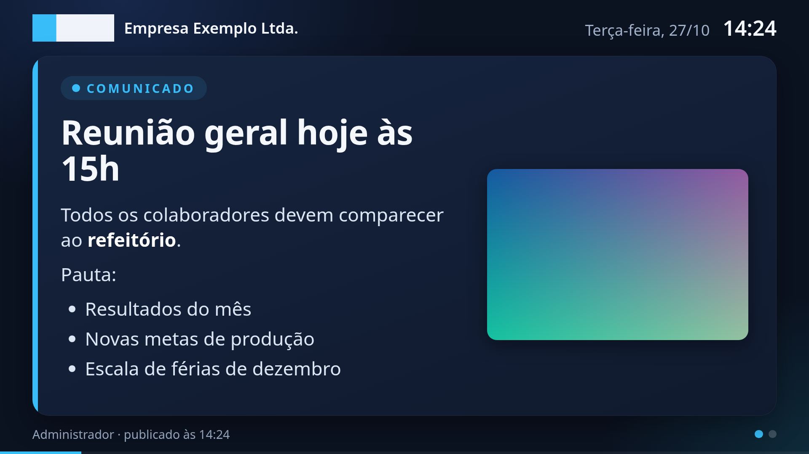
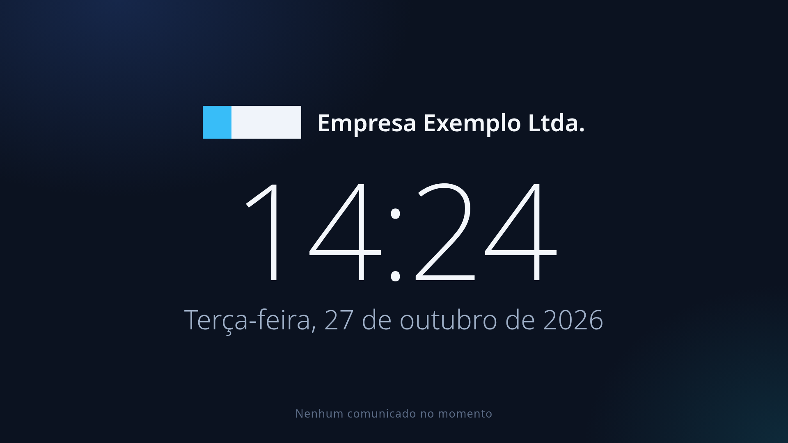
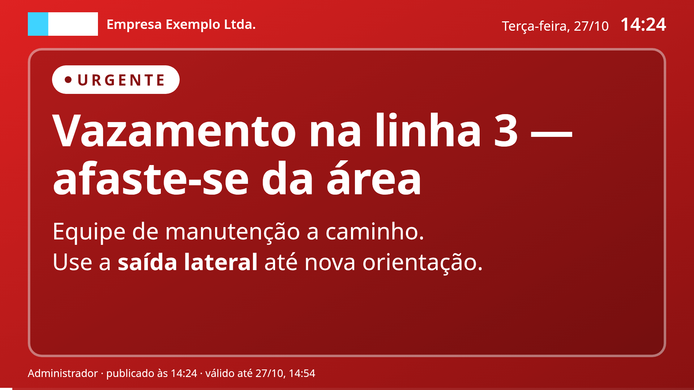
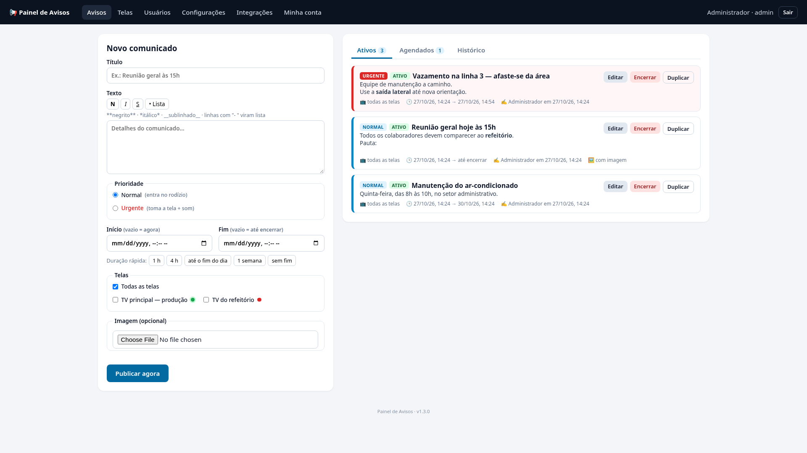
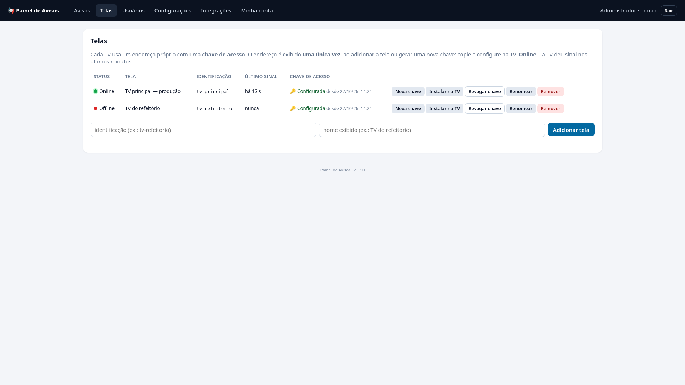
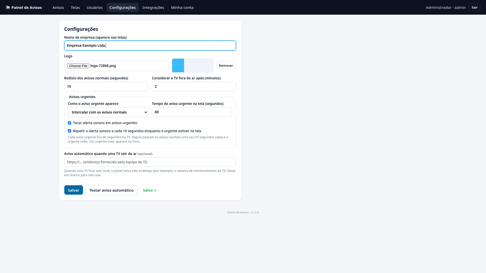
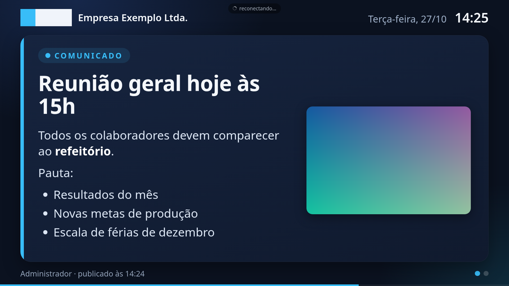

# Painel de Avisos

## O que é

Quadro de comunicados para TVs, administrado pelo navegador. Um único servidor distribui avisos para uma ou várias telas, na rede local ou pela internet.

## Recursos

- Avisos normais em rodízio e urgentes com destaque e som; agendamento e validade.
- Texto com formatação simples, imagens e logo da organização.
- Várias telas, com chaves individuais e seleção dos destinos de cada aviso.
- Usuários administradores e líderes, histórico de ações e 2FA opcional.
- Atualizações em tempo real, reconexão e continuidade com o último conteúdo recebido.
- Cache offline por service worker em HTTPS ou localhost, após o primeiro carregamento.
- Status das TVs, webhook de indisponibilidade e API com token.

## Capturas de tela



| Tela ociosa | Aviso urgente | Administração |
|---|---|---|
|  |  |  |

| Telas e chaves | Configurações | Sem conexão |
|---|---|---|
|  |  |  |

Também disponíveis: [instalar na TV (Windows)](screenshots/10-admin-instalar-na-tv.png), [tela não autorizada](screenshots/07-tela-nao-autorizada.png) e [detalhes técnicos opcionais](screenshots/09-admin-detalhes-tecnicos-opcional.png).

## Como funciona

1. Um servidor Go único entrega a aplicação e os arquivos web embutidos.
2. SQLite guarda avisos, usuários, telas e histórico; imagens ficam na pasta de dados.
3. O painel `/admin` permite publicar e administrar pelo navegador.
4. Cada TV abre `/tela?screen=<nome>&key=<chave>`.
5. SSE entrega alterações em tempo real, com reconexão automática.

## Instalação do servidor

### (a) Docker Compose standalone

Requer Docker e Compose v2. Na raiz do projeto:

```bash
docker compose -p painel-avisos up -d --build
docker compose -p painel-avisos logs painel-avisos
```

Abra `http://IP_DO_SERVIDOR:8080/admin`. O `docker-compose.yml` da raiz publica HTTP na porta 8080 e é ideal para LAN. O nome de projeto explícito mantém o volume `painel-avisos_painel-data`.

**O projeto não tem HTTPS embutido.** Para internet, use a opção (b) ou outro proxy reverso com TLS. Por exemplo, Caddy pode usar `avisos.exemplo.com { reverse_proxy 127.0.0.1:8080 }`; no nginx, configure um servidor TLS com certificado, `proxy_pass http://127.0.0.1:8080`, `proxy_buffering off` para SSE e os cabeçalhos encaminhados. Configure `PUBLIC_URL=https://avisos.exemplo.com` no servidor e `TRUST_PROXY` para o endereço/rede do proxy. Proteja a porta HTTP contra acesso externo direto.

Para exigir chaves também na LAN, habilite `PAINEL_ALLOW_KEYLESS: "0"` no Compose. A configuração padrão da LAN aceita telas sem chave por compatibilidade.

### (b) Atrás de um Traefik existente

Use os arquivos em `deploy/traefik/`. Pré-requisitos: Docker com Compose v2, Traefik v2/v3 com provider Docker, rede externa compartilhada, entrypoint HTTPS e certresolver configurados. O DNS de `avisos.exemplo.com` deve apontar para o endereço público do proxy; libere as portas exigidas pelo desafio ACME escolhido.

Descubra os nomes reais, sem assumir os valores do exemplo:

```bash
docker ps --format '{{.Names}}\t{{.Image}}'
docker inspect <traefik> -f '{{range $k,$v := .NetworkSettings.Networks}}{{$k}} {{end}}'
docker network inspect <rede> -f '{{range .IPAM.Config}}{{.Subnet}}{{end}}'
docker inspect <traefik> -f '{{json .Args}}'
docker inspect <traefik> -f '{{range .Mounts}}{{.Source}} -> {{.Destination}}{{"\n"}}{{end}}'
```

Em `.Args`, procure `entrypoints` e `certificatesresolvers`. Se a configuração estiver em arquivo, consulte a origem indicada em `.Mounts`. As labels de outro serviço publicado também podem indicar os nomes usados.

```bash
cd deploy/traefik
cp .env.example .env
# Edite .env com os nomes e CIDRs encontrados.
chmod 600 .env
docker compose config >/dev/null
docker compose up -d --build
docker compose logs painel-avisos
curl -I https://avisos.exemplo.com/healthz
```

O container não publica portas no host: o Traefik chega à porta 8080 pela rede Docker. Aguarde o estado saudável antes de diagnosticar um 404 inicial.

Todas as variáveis do `.env.example`:

| Variável | Valor de exemplo / função |
|---|---|
| `DOMAIN` | `avisos.exemplo.com`: domínio sem esquema, usado no router e para gerar `PAINEL_PUBLIC_URL=https://${DOMAIN}`. |
| `TRAEFIK_NETWORK` | `proxy`: nome da rede Docker externa do Traefik. |
| `TRAEFIK_ENTRYPOINT` | `websecure`: entrypoint HTTPS existente. |
| `TRAEFIK_CERTRESOLVER` | `letsencrypt`: resolver ACME existente; adapte as labels se sua instalação usar certificados fornecidos por arquivo. |
| `TRUST_PROXY` | `172.16.0.0/12,192.168.0.0/16`: exemplo amplo; prefira o CIDR exato da rede do proxy. Só esses endereços podem informar `X-Forwarded-For/Proto/Host`. |
| `ALLOW_KEYLESS` | `0`: exige chave das TVs. |
| `WEBHOOK_ALLOW_PRIVATE` | `0`: impede webhook para redes privadas. |
| `SHOW_SERVER_INFO` | `0`: oculta detalhes técnicos no painel; `1` exibe para administradores. Os detalhes continuam nos logs. |
| `WEBHOOK_URL` | Vazio: não força uma URL no início; uma URL preenchida substitui a configuração do painel a cada inicialização. |
| `ADMIN_INITIAL_PASSWORD` | Vazio: gera e exibe a senha inicial. Uma senha preenchida só vale na criação do admin. |
| `ADMIN_ALLOWED_IPS` | Opcional: IPs/CIDRs separados por vírgula para o overlay de restrição administrativa. |
| `COMPOSE_FILE` | Opcional: seleciona Compose base e overlay v2 ou v3, conforme abaixo. |
| `BACKUP_DIR` | `/opt/painel-avisos/backups`: destino usado por `backup.sh`. |
| `BACKUP_RETENTION_DAYS` | `14`: retenção dos arquivos de backup. |
| `TZ` | `America/Sao_Paulo`: fuso do container. |

`PUBLIC_URL` é uma configuração do servidor, não uma variável interpolada por esse Compose: nele, altere `DOMAIN` para mudar a URL pública. `PAINEL_VERSION` é opcional nos dois Composes e define a tag da imagem local (padrão `1.3.0`); a compilação usa o código presente na pasta.

#### Restringir o painel por IP

No `.env`, descomente e ajuste:

```dotenv
ADMIN_ALLOWED_IPS=203.0.113.10/32,10.0.0.0/8
COMPOSE_FILE=docker-compose.yml:docker-compose.allowlist-v3.yml
# Para Traefik v2, use docker-compose.allowlist-v2.yml.
```

Execute `docker compose up -d`. Os overlays usam `ipAllowList` (v3) ou `ipWhiteList` (v2) e restringem `/admin`, `/api/admin`, `/api/v1`, `/api/login`, `/api/logout` e `/api/me`. As rotas da TV continuam acessíveis com a chave. Inclua o IP de saída das integrações na lista. Se houver CDN/proxy anterior, ajuste os cabeçalhos confiáveis e a estratégia de IP no Traefik conforme a topologia.

#### SSE e compressão

Evite middleware `compress` nesse router. Se houver compressão global, exclua `text/event-stream` com `excludedContentTypes=text/event-stream`. Bufferização do fluxo pode atrasar os avisos. O servidor envia ping a cada 15 segundos; preserve conexões longas e desative buffering em outros proxies.

### (c) Windows sem Docker

Em Windows 10/11 64 bits, gere o binário com `build.sh` ou disponibilize `painel-avisos.exe`. No PowerShell como Administrador, em `deploy\windows`, execute `Set-ExecutionPolicy -Scope Process Bypass -Force` e `.\install-server.ps1 -RequireScreenKeys` (use `-ExePath C:\caminho\painel-avisos.exe` se necessário). O instalador copia o executável para `C:\PainelAvisos`, mantém dados em `C:\ProgramData\PainelAvisos`, mostra a senha inicial, libera a porta 8080 nas redes Privada/Domínio e cria a tarefa de servidor no boot como SYSTEM. Abra `http://IP_DO_SERVIDOR:8080/admin`; mantenha um endereço fixo/reserva DHCP.

## Primeiro acesso ao admin

Abra `/admin` e entre como `admin` com a senha gerada na saída inicial (`docker compose logs painel-avisos`). Troque a senha em **Minha conta**, ative 2FA, crie usuários e cadastre as telas em **Telas**. Copie a chave exibida uma única vez e use a URL completa na TV. Configure o nome e o logo da organização.

Para recuperar o acesso e remover o 2FA do admin:

```bash
docker compose exec painel-avisos painel-avisos reset-admin
```

No Windows: `C:\PainelAvisos\painel-avisos.exe reset-admin -data C:\ProgramData\PainelAvisos`. Use sempre a mesma pasta de dados do servidor.

## Backup e restauração

No ambiente Traefik, `backup.sh` cria uma cópia consistente do banco e um arquivo separado com uploads, aplicando a retenção configurada. Requer ferramentas como `flock`, `gzip` e `tar`, além de acesso ao Docker.

```bash
./deploy/traefik/backup.sh
./deploy/traefik/restore.sh /opt/painel-avisos/backups/painel-AAAAMMDD-HHMMSS.db.gz /opt/painel-avisos/backups/uploads-AAAAMMDD-HHMMSS.tar.gz
```

A restauração interrompe o serviço e substitui os dados; faça um backup antes. Os scripts operam no Compose de `deploy/traefik/`. Para outras instalações, o comando `painel-avisos backup -data /caminho/dados -out /caminho/backup.db` copia o banco com o servidor ligado; o destino não pode existir. Copie também `uploads/`. Para restaurar manualmente, pare o servidor, substitua banco e uploads, descarte WAL/SHM antigos, confira permissões e reinicie. Guarde cópias fora do servidor e teste a recuperação.

## Atualização

1. Faça backup do banco e dos uploads; preserve seu `.env` e ajustes locais.
2. Substitua os arquivos do projeto pela versão desejada e revise novas opções no `.env.example`.
3. Se definiu `PAINEL_VERSION`, ajuste a tag. Execute `docker compose up -d --build` no mesmo diretório e com o mesmo nome de projeto (`-p painel-avisos` na instalação standalone acima).
4. Confira `docker compose ps`, logs e `/healthz`, e teste uma TV.

Os dados ficam no volume **`painel-avisos_painel-data`** usando o nome de projeto indicado. **Nunca use `docker compose down -v`**, pois apaga o volume. No Windows, substitua o binário e rode `install-server.ps1` novamente; os dados são preservados. Para atualizar o lançador da TV, execute novamente o instalador de quiosque com os mesmos parâmetros.

## Referência de variáveis de ambiente e flags

Flags têm precedência sobre o ambiente. Nas opções com dois nomes de variável, `PAINEL_...` tem precedência sobre o nome curto.

| Flag | Variável de ambiente | Padrão / função |
|---|---|---|
| `-port` | `PAINEL_PORT` | `8080`, porta HTTP. |
| `-bind` | `PAINEL_BIND` | Vazio, todas as interfaces. |
| `-data` | `PAINEL_DATA` | Pasta `data` ao lado do executável; banco e uploads. Docker: `/data`. |
| `-admin-password` | `PAINEL_ADMIN_PASSWORD` | Vazio gera senha, somente no primeiro uso. |
| `-auto-register` | `PAINEL_AUTO_REGISTER` | `1`; `0` desativa cadastro automático de telas sem chave no modo legado. |
| `-webhook` | `PAINEL_WEBHOOK_URL` | Vazio; se preenchido, sobrescreve a URL do painel ao iniciar. |
| `-public-url` | `PAINEL_PUBLIC_URL` / `PUBLIC_URL` | Vazio; HTTPS ativa cookie Secure e padrões de modo público. Não habilita TLS no servidor. |
| `-trust-proxy` | `PAINEL_TRUST_PROXY` / `TRUST_PROXY` | Vazio ignora cabeçalhos encaminhados; aceita IPs/CIDRs separados por vírgula. |
| `-allow-keyless` | `PAINEL_ALLOW_KEYLESS` / `ALLOW_KEYLESS` | `auto`: aceita sem URL pública HTTPS, exige chave com HTTPS; `1`/`0` força. |
| `-webhook-allow-private` | `PAINEL_WEBHOOK_ALLOW_PRIVATE` / `WEBHOOK_ALLOW_PRIVATE` | `auto`: permite redes privadas na LAN, bloqueia no modo público; `1`/`0` força. |
| `-show-server-info` | `PAINEL_SHOW_SERVER_INFO` / `SHOW_SERVER_INFO` | `0`; `1` mostra detalhes técnicos só para admin. |
| `-out` | — | Destino obrigatório do comando `backup`. |

Comandos: `serve` (também padrão sem comando), `version`, `reset-admin` e `backup -out ARQUIVO`. `-h` exibe a ajuda. Loopback, link-local e metadados de nuvem continuam bloqueados para webhook mesmo permitindo redes privadas.

## Instalar a TV no Windows

### Pelo painel (recomendado)

1. Na aba **Telas**, clique em **Instalar na TV** ao lado da tela desejada.
2. No PC Windows ligado à TV, abra o PowerShell e copie os comandos do passo 1 para baixar o instalador e identificar os monitores.
3. Escolha o monitor, se necessário, e o logon automático, se desejar. Cole sua chave ou clique em **Gerar nova chave**.
4. Copie o comando de instalação ou baixe o instalador configurado `.bat` e execute-o. Para logon automático, execute como administrador.

A chave só aparece quando é gerada: o servidor guarda apenas seu hash. Por isso, o botão permite gerar uma nova; a anterior deixa de funcionar imediatamente e a TV precisa ser reconfigurada. O `.bat` contém a chave: não compartilhe e apague depois de usar.

A URL base vem de `PUBLIC_URL`; quando não configurada, usa os cabeçalhos `X-Forwarded-Proto` e `X-Forwarded-Host` somente se a conexão vier de um proxy listado em `TRUST_PROXY`. Nos demais casos, usa o endereço usado para abrir o painel. O endpoint `/install/tv-kiosk.ps1` é público, funciona sem sessão e não contém segredos.

### Pelo script

Requer Windows 10/11 64 bits, Microsoft Edge instalado, PowerShell e acesso ao servidor. Cadastre a tela no admin e copie a chave. Execute em uma sessão do usuário que exibirá a TV, na pasta `deploy\windows`:

```powershell
Set-ExecutionPolicy -Scope Process Bypass -Force
.\install-tv-kiosk.ps1 -ListMonitors
.\install-tv-kiosk.ps1 -Url https://avisos.exemplo.com -Screen tv-principal -Key tk_SUA_CHAVE -Monitor 1
# LAN: troque -Url por -Server 192.168.0.50:8080
```

`-Monitor` aceita o número mostrado por `-ListMonitors` ou `DISPLAYn`; sem ele, usa o principal. A numeração pode diferir das Configurações do Windows. Para várias telas no mesmo PC, execute uma vez por `-Screen`, cada qual com sua chave e monitor. Cada tela tem tarefa, perfil do Edge e lançador próprios.

O script cria a tarefa agendada interativa `PainelAvisos-Kiosk-<tela>` no logon, abre o Edge em quiosque e o reabre se for fechado. O lançador fica em `C:\PainelAvisos\tv-kiosk-<tela>.ps1`; o log em `%LOCALAPPDATA%\PainelAvisos\tv-kiosk-<tela>.log`. É preciso entrar no Windows para a tarefa funcionar.

```powershell
# Logon automático: exige PowerShell como Administrador; solicita credenciais.
.\install-tv-kiosk.ps1 -AutoLogon
# Diagnóstico e remoção de uma tela (sem parâmetros de instalação):
.\install-tv-kiosk.ps1 -Status -Screen tv-principal
.\install-tv-kiosk.ps1 -Uninstall -Screen tv-principal
# Desativar logon automático separadamente, como Administrador:
.\install-tv-kiosk.ps1 -DisableAutoLogon
```

`-AutoLogon` pode acompanhar a instalação; `-AutoLogonUser DOMINIO\usuario` seleciona a conta. A senha é armazenada como segredo LSA. Remover uma tela mantém o logon automático; use `-DisableAutoLogon` para desativá-lo.

Para iniciar no logon de qualquer usuário, acrescente `-AllUsers` à instalação e execute como Administrador. **Com `-AllUsers`, a chave no lançador fica legível por usuários locais.** Perfil e log continuam separados por usuário.

Se não iniciar, use `-Status`, confira a tarefa e o log, o Edge instalado e a conectividade. Para monitor errado, repita `-ListMonitors` e reinstale com o número correto. Para chave revogada, gere outra no painel e reinstale. Se o PC suspender, confira `deploy/windows/disable-sleep-screensaver.txt`; para retorno após falta de energia, configure a opção equivalente a “Power On” na BIOS/UEFI.

## Outras TVs

Em Smart TV, Raspberry Pi, Linux ou navegador disponível no Chromecast/Fire TV, basta abrir `https://SEU_DOMINIO/tela?screen=<nome>&key=<chave>` em tela cheia. O navegador precisa suportar JavaScript e SSE; disponibilidade de navegador e recursos varia por dispositivo.

No Raspberry Pi/Linux, por exemplo:

```bash
chromium-browser --kiosk --autoplay-policy=no-user-gesture-required "URL"
```

Adicione o comando ao autostart da sessão gráfica para abrir ao entrar no sistema. O nome do executável pode ser `chromium` na sua distribuição. **O som exige o flag de autoplay ou um clique na página**, conforme a política do navegador.

## Avisos urgentes

Em **Configurações > Avisos urgentes**, ajuste as três opções do ciclo:

1. **Modo:** intercalar com avisos normais (padrão) ou fixar na tela até sair do ar.
2. **Tempo do urgente:** 10 a 600 segundos, padrão 60.
3. **Repetir alerta a cada 10 segundos:** ligado por padrão; há também o controle geral para ligar/desligar o som.

No padrão: urgente por 60 s com alertas → cada aviso normal uma vez (15 s por padrão) → urgente novamente. Vários urgentes passam em sequência antes dos normais. Sem normais, o urgente permanece e renova o período de alerta. No modo fixo, os normais ficam suspensos e a repetição sonora ocorre só durante o período inicial configurado. Urgente novo ou editado interrompe imediatamente o aviso normal.

## API com token

Gere um token em **Integrações** como admin e guarde-o: ele aparece uma única vez. A restrição administrativa por IP também abrange esta API.

```bash
curl -X POST https://avisos.exemplo.com/api/v1/announcements \
  -H 'Authorization: Bearer pa_SEU_TOKEN' -H 'Content-Type: application/json' \
  -d '{"title":"Manutenção","body":"Equipe atuando.","priority":"urgent","durationMinutes":30}'
curl -H 'Authorization: Bearer pa_SEU_TOKEN' 'https://avisos.exemplo.com/api/v1/announcements?view=active'
curl -X POST -H 'Authorization: Bearer pa_SEU_TOKEN' https://avisos.exemplo.com/api/v1/announcements/42/end
curl -H 'Authorization: Bearer pa_SEU_TOKEN' https://avisos.exemplo.com/api/v1/screens
```

`title` é obrigatório (até 120 caracteres), `body` aceita até 3000 e `priority` aceita `normal`/`urgent`. `startsAt` e `endsAt` usam segundos Unix; `durationMinutes` é alternativa ao fim explícito. Sem fim, permanece até encerrar. Para selecionar telas, use `allScreens:false` e `screens:["tv-principal"]`; sem seleção, o padrão é todas. `image` aceita um caminho `/uploads/...` já enviado pelo painel.

## Integração com monitoramento (Zabbix)

Configure uma ação/media type que faça o POST da API no evento de problema e guarde o ID retornado para encerrar no evento de recuperação. Use token dedicado, duração de segurança e permita o IP de saída do monitoramento no overlay administrativo. Monitore também `/healthz`. O webhook configurado no painel avisa quando uma TV fica offline e quando volta; destinos privados dependem de `WEBHOOK_ALLOW_PRIVATE`.

## Segurança

Senhas usam bcrypt; sessões, tokens e chaves de TV são guardados como hash. Há 2FA opcional, limitação de tentativas de login, proteção CSRF, CSP e uploads protegidos por sessão ou chave. Em HTTPS, os cookies são Secure e há HSTS; confie apenas nos proxies necessários. O webhook valida destinos a cada conexão e redirecionamento contra SSRF. Proteja banco e backups, que contêm segredos TOTP. Chaves nas URLs podem aparecer em logs do proxy: restrinja o acesso a esses registros. Exija chaves na LAN e mantenha o admin restrito quando possível.

## Solução de problemas

| Sintoma | Verificação |
|---|---|
| Tela não autorizada | Chave incorreta/revogada: gere outra e atualize a URL/instalação. |
| Traefik 404 ou 502 | Estado saudável, domínio, entrypoint e rede compartilhada; consulte logs. |
| Certificado inválido | DNS, portas ACME e certresolver. |
| Atualização atrasada | Exclua `text/event-stream` da compressão e desative buffering. |
| Login em loop | Acesse por HTTPS quando a URL pública usar HTTPS; confira `TRUST_PROXY`. |
| Admin retorna 403 | Inclua seu IP em `ADMIN_ALLOWED_IPS`. |
| Sem som | Confira volume, flag de autoplay ou clique na página. |
| LAN inacessível | Confira firewall, perfil Privado/Domínio e porta 8080. |
| Webhook bloqueado | Revise destino e permissão de redes privadas; loopback/metadados seguem bloqueados. |

## Testes e desenvolvimento

Requer Go 1.26+. SQLite usa `modernc.org/sqlite`, sem CGO; o front-end em `web/` é embutido no binário.

```bash
./build.sh                         # gera binários Windows/Linux amd64 em dist/
go vet ./...
go test ./...
python3 tests/smoke_test.py dist/painel-avisos-linux-amd64
```

Os testes Go verificam também a URL base e o instalador público; o smoke confere o download sem sessão nos modos público e LAN.

Em `tests/`, `browser_test.mjs` usa `puppeteer-core` e Chrome para interface, instalação na TV (comando, monitor, logon automático e download `.bat`), CSP e offline; `urgent_test.mjs` usa `playwright-core` para o ciclo urgente; `traefik_test.py` exercita o proxy real com Docker. Consulte os cabeçalhos dos scripts para parâmetros e dependências. `kiosk_autostart_test.ps1` e `kiosk_monitor_test.ps1` rodam com `pwsh -NoProfile -File tests/NOME.ps1` e mocks; não substituem validação em Windows real. Os resultados históricos ficam em `tests/results/` e `tests/*_result.txt`. `dist/` é gerado localmente e ignorado pelo Git.

Histórico de versões: [CHANGELOG.md](CHANGELOG.md).

## Licença

**TODO: Defina a licença do projeto.**
